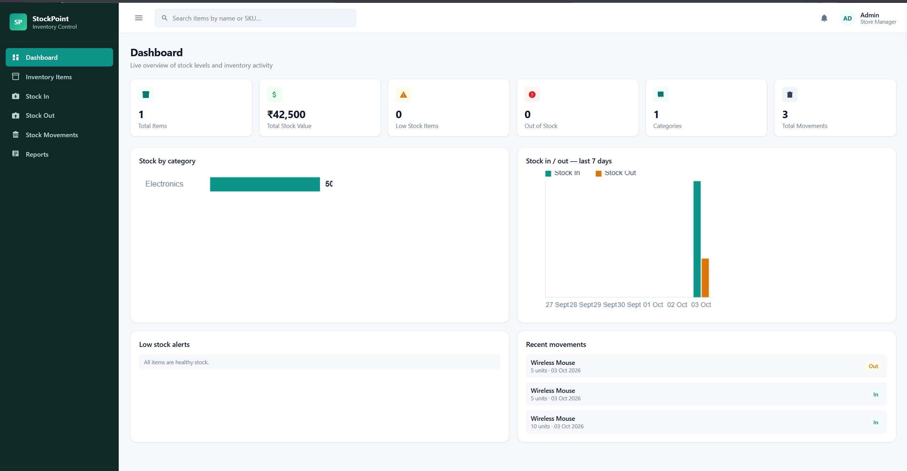
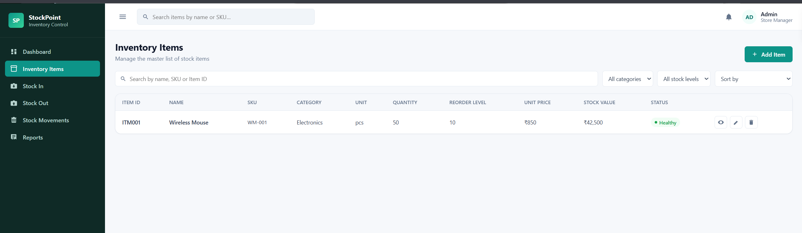
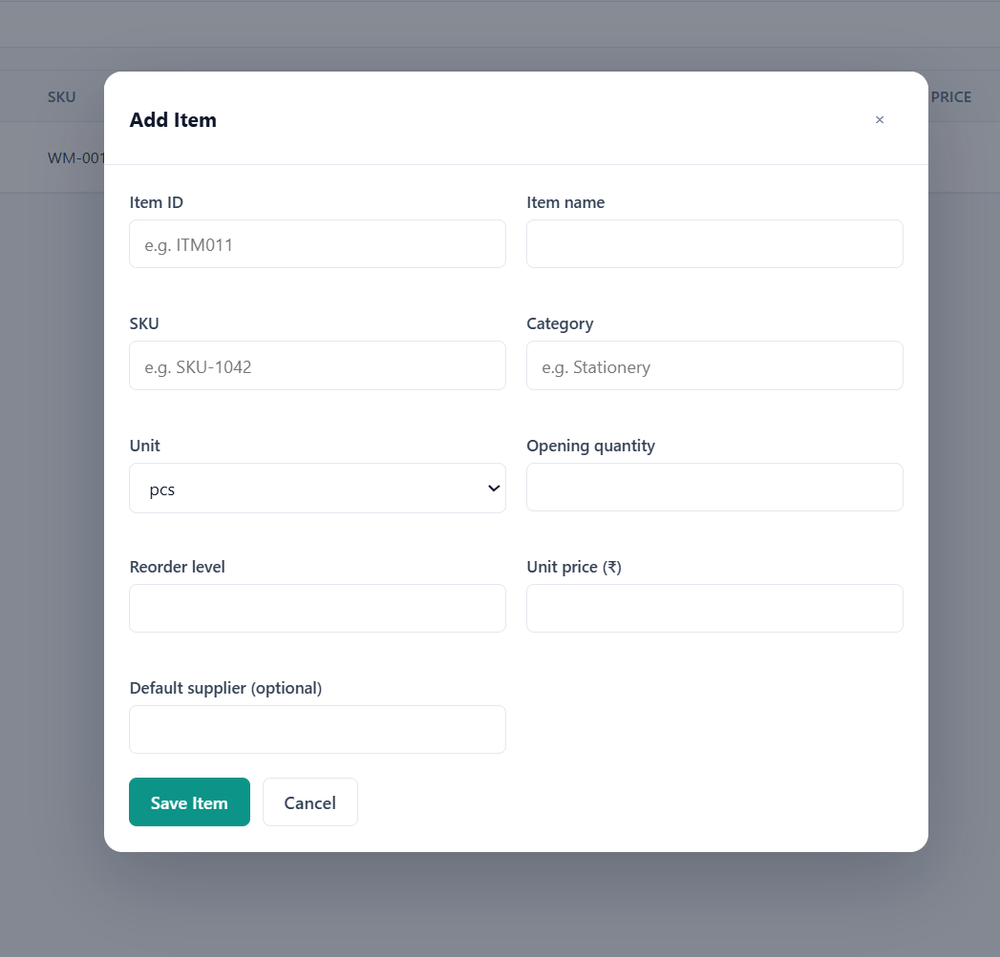
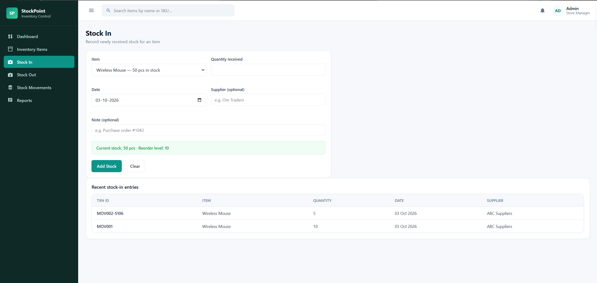
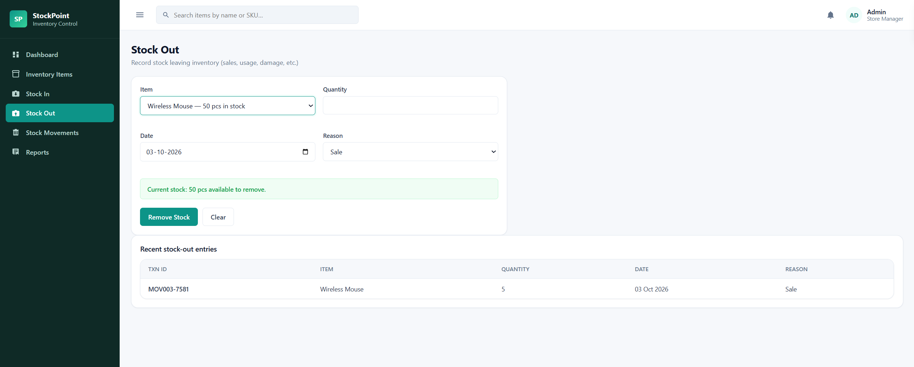
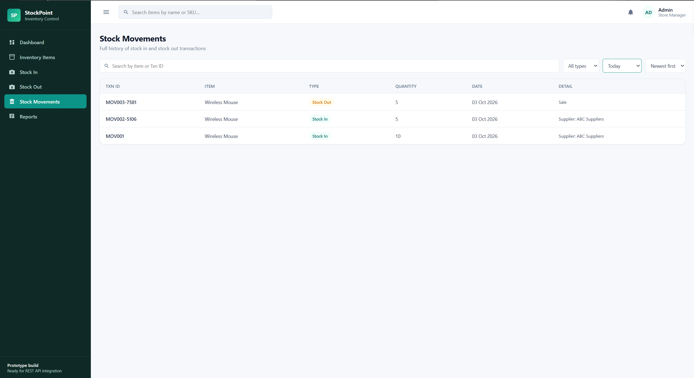
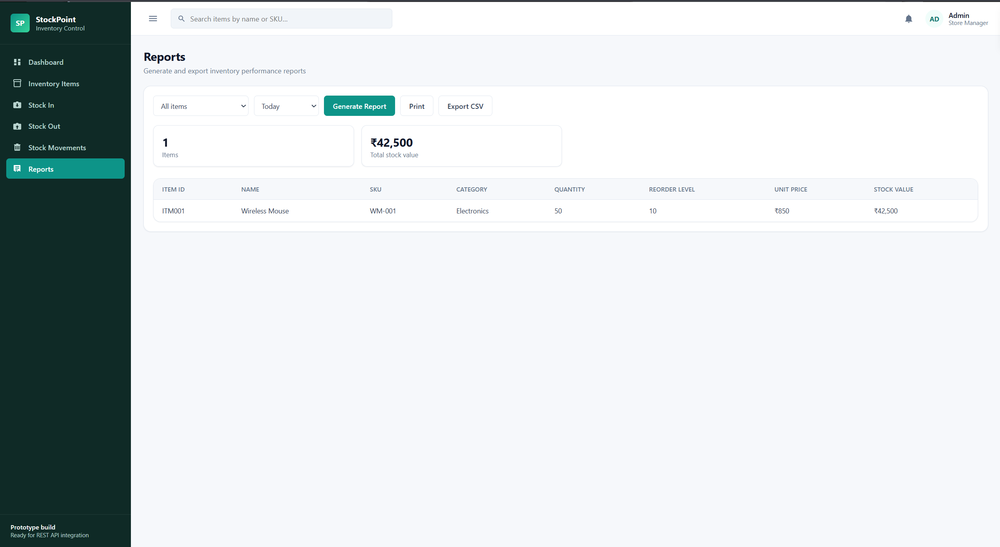

# StockPoint - Inventory Management System

Built as Task 3 of the Auspify Software Development Internship.

## About the Project

StockPoint is a full-stack Inventory Management System developed to manage inventory items and track stock movement.

The system allows users to add, view, update and delete inventory items, record stock-in and stock-out transactions, monitor stock levels, view movement history, generate reports and export inventory data as CSV.

## Technologies Used

- HTML
- CSS
- JavaScript
- Node.js
- Express.js
- MongoDB
- Mongoose
- MongoDB Atlas

## Main Features

- Add inventory items
- View inventory items
- Edit inventory items
- Delete inventory items
- Stock In
- Stock Out
- Stock availability validation
- Stock movement history
- Dashboard
- Inventory reports
- CSV export
- Search and filtering
- Low-stock monitoring
- MongoDB database storage

## Project Architecture

Frontend (HTML, CSS, JavaScript)

↓

Node.js + Express.js Backend

↓

MongoDB Atlas Database

## How to Run

1. Clone the repository
```bash
   git clone https://github.com/priyanshuattri657/inventory-management-system.git
   cd inventory-management-system
```

2. Install dependencies
```bash
   npm install
```

3. Create a `.env` file
```
   PORT=5000
   MONGO_URI=your_mongodb_connection_string
```

4. Start the server
```bash
   npm run dev
```

5. Open `index.html` in your browser.

> In `script.js`, the `API` constant points to the deployed backend. For local use, change it to `http://localhost:5000/api`.

## API Endpoints

| Method | Endpoint | Description |
|---|---|---|
| GET | `/api/items` | List all items |
| GET | `/api/items/:id` | Get one item |
| POST | `/api/items` | Add an item |
| PUT | `/api/items/:id` | Update an item |
| DELETE | `/api/items/:id` | Delete an item |
| GET | `/api/movements` | List all stock movements |
| POST | `/api/movements` | Record a stock movement |
| DELETE | `/api/movements/:id` | Delete a movement |

## Screenshots

### Dashboard


### Inventory Items


### Add Item


### Stock In


### Stock Out


### Stock Movement


### Reports


## Author

**Priyanshu Attri**
GitHub: [priyanshuattri657](https://github.com/priyanshuattri657) · LinkedIn: [priyanshuattri](https://linkedin.com/in/priyanshuattri)

#Auspify #AuspifyTechnologies #AuspifyInternship #AuspifyProjects